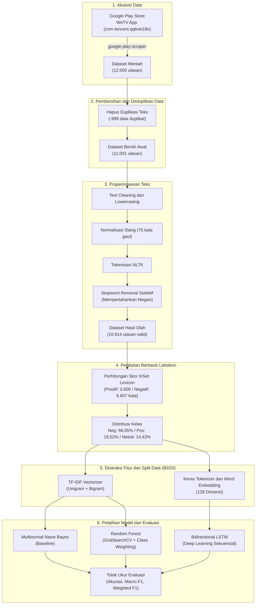

<p align="right">
  <a href="README.md">English</a> • <strong>Bahasa Indonesia</strong>
</p>

# Analisis Sentimen Ulasan Aplikasi WeTV

[](https://www.python.org/)
[](https://tensorflow.org/)
[](https://keras.io/)
[](https://scikit-learn.org/)
[](LICENSE)

Proyek _Natural Language Processing_ (NLP) _end-to-end_ untuk mengklasifikasikan ulasan pengguna aplikasi _streaming_ **WeTV** (`com.tencent.qqlivei18n`) pada Google Play Store Indonesia ke dalam 3 kelas sentimen: **Positif**, **Netral**, dan **Negatif**. Proyek ini membandingkan kinerja model _machine learning_ klasik dengan arsitektur _deep learning_ sekuensial (Bidirectional LSTM) menggunakan pelabelan polaritas berbasis leksikon (_lexicon-based labeling_).

---

## Arsitektur dan Alur Pipeline



## Ringkasan Dataset

- **ID Aplikasi:** `com.tencent.qqlivei18n` (Google Play Store)
- **Total Data Mentah:** 12.000 baris ulasan dengan 11 kolom atribut
- **Total Data Bersih:** 10.914 baris ulasan valid setelah deduplikasi (-999) dan penghapusan teks kosong pascaprapemrosesan (-87)
- **Metode Pelabelan:** Skema polaritas otomatis menggunakan kamus **InSet Lexicon** Bahasa Indonesia:
  - **Negatif:** Skor polaritas < 0 (7.209 ulasan / 66,05%)
  - **Positif:** Skor polaritas > 0 (2.130 ulasan / 19,52%)
  - **Netral:** Skor polaritas = 0 (1.575 ulasan / 14,43%)
- **Pembagian Data:** 80% data latih, 20% data uji (_stratified split_)

## Tahapan Prapemrosesan Teks

1. **Text Cleaning:** Menghapus _mention_ (`@user`), tagar, URL, angka, tanda baca, dan spasi berlebih.
2. **Case Folding:** Menyeragamkan seluruh karakter teks menjadi huruf kecil (_lowercase_).
3. **Normalisasi Slang:** Mengonversi singkatan dan bahasa gaul khas ulasan WeTV menjadi kata baku menggunakan kamus terkurasi berisi 75 kata unik (misal: `gak`/`ngga` → `tidak`, `lemot` → `lambat`, `apk` → `aplikasi`).
4. **Tokenisasi:** Memecah kalimat ulasan menjadi token kata individual menggunakan NLTK `word_tokenize`.
5. **Stopword Removal Selektif:** Menghapus kata umum Bahasa Indonesia dan Inggris tanpa menghilangkan kata negasi kunci (`tidak`, `bukan`, `jangan`, `belum`, `kurang`, `tanpa`) agar makna polaritas kalimat tetap utuh.

## Ringkasan Kinerja Model

| Skema Pemodelan             | Representasi Fitur       | Akurasi Uji | F1-Score (Macro) | F1-Score (Weighted) | Keterangan                                                   |
| :-------------------------- | :----------------------- | :---------- | :--------------- | :------------------ | :----------------------------------------------------------- |
| **Multinomial Naive Bayes** | TF-IDF (1-2 n-grams)     | 71,83%      | 0,4521           | 0,6428              | Model _baseline_ probabilistik                               |
| **Random Forest**           | TF-IDF (1-2 n-grams)     | 86,07%      | 0,8070           | 0,8606              | Optimasi _balanced class weights_                            |
| **Bidirectional LSTM**      | Word Embedding (128-dim) | **89,37%**  | **0,8426**       | **0,8961**          | **Model terbaik** (menangkap konteks urutan dan kata negasi) |

## Tech Stack

- **Bahasa dan Lingkungan Eksekusi:** Python 3.11.x (lingkungan WSL2 / Ubuntu)
- **Deep Learning Framework:** TensorFlow 2.22, Keras 3.15
- **Machine Learning dan NLP:** Scikit-Learn 1.9, NLTK 3.10
- **Pengambilan dan Manipulasi Data:** google-play-scraper 1.2.7, Pandas 3.0, NumPy 2.5
- **Visualisasi Data:** Matplotlib 3.11, Seaborn 0.13, WordCloud 1.9

## Panduan Menjalankan Proyek

### Opsi A: Eksekusi Lokal (WSL2 / Linux / macOS)

1. **Clone repositori:**

   ```bash
   git clone https://github.com/mmryd/wetv-sentiment-analysis.git
   cd wetv-sentiment-analysis
   ```

2. **Buat dan aktifkan _virtual environment_ (Python 3.11):**

   ```bash
   python3.11 -m venv wetv-env
   source wetv-env/bin/activate
   ```

3. **Pasang dependensi pustaka:**

   ```bash
   pip install --upgrade pip
   pip install -r requirements.txt
   ```

4. **Jalankan Jupyter Notebook:**

   ```bash
   jupyter notebook
   ```

   Buka `wetv-scraping.ipynb` untuk alur penarikan data ulasan, atau `wetv-sentiment-analysis.ipynb` untuk alur prapemrosesan, analisis data, dan pelatihan model.

### Opsi B: Eksekusi via Google Colab

1. Unggah berkas `wetv-scraping.ipynb` dan `wetv-sentiment-analysis.ipynb` ke Google Colab.
2. Ubah tipe runtime ke **T4 GPU** untuk akselerasi pelatihan model BiLSTM (Runtime → Change runtime type → T4 GPU).
3. Pasang paket scraper dan dependensi tambahan pada sel pertama:

   ```python
   !pip install google-play-scraper nltk wordcloud
   ```

## Lisensi

Proyek ini dirilis di bawah lisensi MIT. Lihat berkas [LICENSE](LICENSE) untuk informasi selengkapnya.
