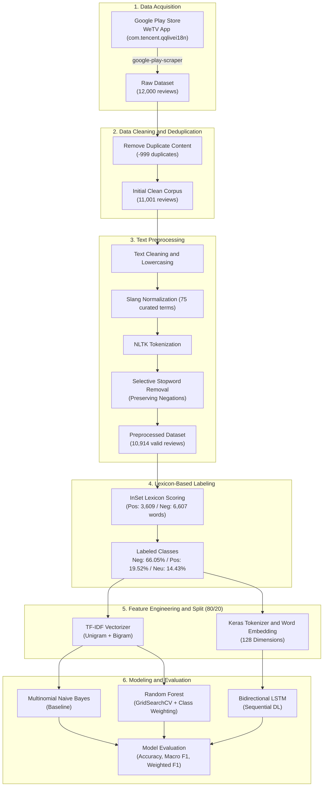

<p align="right">
  <strong>English</strong> • <a href="README.id.md">Bahasa Indonesia</a>
</p>

# WeTV App Reviews Multi-Class Sentiment Analysis

[](https://www.python.org/)
[](https://tensorflow.org/)
[](https://keras.io/)
[](https://scikit-learn.org/)
[](LICENSE)

An end-to-end natural language processing (NLP) project classifying user reviews of the **WeTV** mobile streaming application (`com.tencent.qqlivei18n`) on Google Play Store Indonesia into 3 sentiment categories: **Positive**, **Neutral**, and **Negative**. The project compares classical machine learning algorithms against a sequential deep learning architecture (Bidirectional LSTM) using lexicon-based sentiment polarity labeling.

---

## Architecture and Pipeline



## Dataset Summary

- **Application ID:** `com.tencent.qqlivei18n` (Google Play Store)
- **Raw Extracted Data:** 12,000 reviews across 11 features
- **Clean Corpus:** 10,914 non-empty reviews after deduplication (-999) and preprocessing filtering (-87)
- **Labeling Strategy:** Automated polarity calculation using the **InSet Lexicon** (Indonesian Sentiment Lexicon):
  - **Negative:** Score < 0 (7,209 samples / 66.05%)
  - **Positive:** Score > 0 (2,130 samples / 19.52%)
  - **Neutral:** Score = 0 (1,575 samples / 14.43%)
- **Data Split:** 80% training set, 20% testing set (*stratified split*)

## Text Preprocessing Highlights

1. **Text Sanitization:** Removal of user mentions (`@user`), hashtags, URLs, numeric digits, punctuation, and redundant whitespace.
2. **Case Folding:** Normalizing all textual characters to lowercase.
3. **Slang Normalization:** Replacing informal terms and colloquial Indonesian abbreviations using a curated dictionary of 75 slang terms specific to streaming review contexts (e.g., `gak`/`ngga` → `tidak`, `lemot` → `lambat`, `apk` → `aplikasi`).
4. **Tokenization:** Word-level boundary splitting using NLTK `word_tokenize`.
5. **Selective Stopword Filtering:** Filtering out high-frequency stopwords while retaining critical negation markers (`tidak`, `bukan`, `jangan`, `belum`, `kurang`, `tanpa`) to preserve contextual polarity for the classifier.

## Model Performance Benchmark

| Model Scheme | Input Representation | Test Accuracy | Macro F1-Score | Weighted F1-Score | Remarks |
| :--- | :--- | :--- | :--- | :--- | :--- |
| **Multinomial Naive Bayes** | TF-IDF (1-2 n-grams) | 71.83% | 0.4521 | 0.6428 | Probabilistic baseline model |
| **Random Forest** | TF-IDF (1-2 n-grams) | 86.07% | 0.8070 | 0.8606 | Tuned with balanced class weights |
| **Bidirectional LSTM** | Word Embedding (128-d) | **89.37%** | **0.8426** | **0.8961** | **Best model** (captures temporal context and negation) |

## Tech Stack

- **Language and Runtime:** Python 3.11.x (tested on Ubuntu / WSL2)
- **Deep Learning Framework:** TensorFlow 2.22, Keras 3.15
- **Machine Learning and NLP:** Scikit-Learn 1.9, NLTK 3.10
- **Data Scraping and Analysis:** google-play-scraper 1.2.7, Pandas 3.0, NumPy 2.5
- **Data Visualization:** Matplotlib 3.11, Seaborn 0.13, WordCloud 1.9

## Getting Started

### Option A: Local Setup (WSL2 / Linux / macOS)

1. **Clone the repository:**

   ```bash
   git clone https://github.com/mmryd/wetv-sentiment-analysis.git
   cd wetv-sentiment-analysis
   ```

2. **Create and activate a virtual environment (Python 3.11):**

   ```bash
   python3.11 -m venv wetv-env
   source wetv-env/bin/activate
   ```

3. **Install dependencies:**

   ```bash
   pip install --upgrade pip
   pip install -r requirements.txt
   ```

4. **Launch Jupyter Notebook:**

   ```bash
   jupyter notebook
   ```

   Open `wetv-scraping.ipynb` to inspect data collection, or `wetv-sentiment-analysis.ipynb` for model training and evaluation.

### Option B: Google Colab Setup

1. Upload `wetv-scraping.ipynb` and `wetv-sentiment-analysis.ipynb` to your Colab workspace.
2. Set the runtime type to **T4 GPU** for faster training of the BiLSTM model (Runtime → Change runtime type → T4 GPU).
3. Install the required scraper and dependencies in the first notebook cell:

   ```python
   !pip install google-play-scraper nltk wordcloud
   ```

## License

This project is licensed under the MIT License. See the [LICENSE](LICENSE) file for details.
